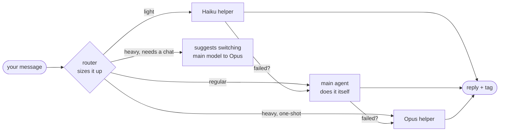

<div align="center">



<br>

[](#roadmap)
[](LICENSE)
[](#works-with)

**Stop paying Opus prices to change a button colour.**

One skill. Every agent. It sizes up each message and hands the work to the cheapest model that can do it well.

[How it works](#how-it-works) · [Works with](#works-with) · [Install](#install) · [Modes](#auto-or-manual) · [FAQ](#faq)

</div>

---

## The problem

You ask your agent to rename a variable. It spins up the biggest, most expensive model you have. You ask it to fix a typo in a heading. Same model. A three-line caption? Same model again.

Most of a normal working day is small stuff. Paying top-tier prices for all of it burns through your tokens, your quota and your patience.

## The fix

<div align="center">

</div>

model-router sits inside your agent and asks one question before every task: **how hard is this, really?**

| Tier | Claude model | What lands here |
|:---:|:---:|---|
| 🟦 **Light** | Haiku | colour and spacing tweaks, renames, typos, formatting, short copy, quick lookups |
| 🟪 **Regular** | Sonnet | features across a few files, research, articles, explaining code, debugging a clear error |
| 🟧 **Heavy** | Opus | architecture, maths and calculations, bugs that survived a first fix, security work, big refactors |

Not sure? It rounds **up**. A cheap answer that's wrong costs more than an expensive one that's right.

## See it in action

<div align="center">

</div>

You type the way you always do. The switching happens on its own, and every reply ends with a small tag so you always know who did the work:

```text
[router: light → haiku]
```

## How it works



1. **Size it up.** The main agent reads your message and picks light, regular or heavy.
2. **Route it.** Same tier as the main model? It just does the job. Different tier? It hands the job to a helper locked to the right model.
3. **Brief it properly.** Helpers get the exact file, the exact line and what "done" means, so they don't waste tokens searching.
4. **Catch mistakes.** If a helper fails or isn't sure, the task moves one tier up. Nothing fails quietly.
5. **Too small to bother?** If writing the brief would cost more than doing the edit, the main agent does it itself.

> [!TIP]
> Run your main session on **Sonnet**. Routing happens on a mid-priced model, regular work needs no handoff, and only the hard stuff goes to Opus.

### Shared memory

Helpers start with a blank slate, so the router keeps a tiny notes file at `.model-router/context.md`:

```text
Project: Next.js site, Tailwind
Key files: app/page.tsx (home), components/Button.tsx
Decisions: brand green = #16a34a, no new dependencies
Current task: redesigning signup flow
```

Every helper reads it first instead of crawling your whole project. It stays under about 40 lines and never stores secrets, keys or personal data.

## Auto or manual

<table>
<tr>
<td width="50%" valign="top">

### ⚡ Auto mode (default)

The agent switches models by itself. You chat, it routes, and the tag tells you what happened.

</td>
<td width="50%" valign="top">

### 🎛️ Manual mode

The agent stays on whatever model you picked. When the tier changes, it suggests one line:

`Light task: switch to Haiku to save tokens.`

It says this only when the tier changes, not on every message.

</td>
</tr>
</table>

Switch any time by typing:

```text
router auto
router manual
```

Your choice is saved per project.

## Works with

Most coding agents can now run helper agents locked to one model, and that's what the router uses. Honesty matters more to us than a long list, so each agent is marked by what has actually been tested.

| Agent | Auto mode | Status |
|---|:---:|---|
| **Claude Code** | ✅ | verified: installs, hands one-shot heavy work to Opus, uninstall restores `CLAUDE.md` byte for byte |
| **Codex** | ✅ | not yet verified, ships in manual mode until it is |
| **Gemini CLI** | ✅ | not yet verified, ships in manual mode until it is |
| **GitHub Copilot** | ✅ | offers Claude or OpenAI models; not yet verified; stays manual if each handoff costs an extra premium request |
| **OpenCode** | ➖ | skill + instruction line only, no helpers until model IDs are confirmed |
| **Cursor** | ➖ | skill only; the installer prints the line to paste into Cursor's rules. No helpers until model IDs are confirmed |
| **Aider** | ➖ | manual only (its model roles are fixed, not per message) |
| **Windsurf, Cline, Roo** | ➖ | manual only (no confirmed way to run helpers on their own model) |

Unverified agents can still opt in with `router auto` (agents with helpers only). Want to help verify one? See [Contributing](#contributing).

> [!TIP]
> **Aider** already has its own split. Run it in architect mode with a heavy-tier model as the architect and a light-tier model as the editor, for example `aider --architect --model opus --editor-model haiku`.

## Install

> [!NOTE]
> model-router isn't on npm yet. From a clone, run `node bin/model-router.js install`. The `npx` commands below are what it will look like once published.

```bash
npx model-router install
```

The installer:

- finds which agents you have and installs the skill into each one's user folder, so it works in every project, plus three helpers (`router-light`, `router-regular`, `router-heavy`) for the agents that support them (Claude Code, Codex, Gemini CLI, Copilot)
- asks which company's models to use when an agent offers several (today only Copilot), defaulting to Claude
- **asks before** adding a short, clearly marked block to each agent's always-on instructions file (`CLAUDE.md`, `AGENTS.md`, `GEMINI.md` and so on), so the router runs on every message
- never overwrites a file it didn't create

Changed your mind?

```bash
npx model-router uninstall
```

That removes everything it added, including just its own block inside your instruction files.

## FAQ

<details>
<summary><b>Does it really switch models in the middle of a conversation?</b></summary>
<br>
Your main conversation stays on one model; most agents only let you change that yourself. What the router does is hand each task to a helper that runs on a different model. From your side, it looks and feels like switching, and the tag shows you which model did the work.
</details>

<details>
<summary><b>Does it work with subscriptions like Claude Pro/Max or ChatGPT Plus?</b></summary>
<br>
Yes. It uses features built into the agents themselves, not your API keys or a proxy server.
</details>

<details>
<summary><b>Will a cheaper model make my work worse?</b></summary>
<br>
Light tasks go to Haiku only when they're clearly small and well defined. When in doubt it rounds up, and if a helper fails, the task moves up a tier automatically.
</details>

<details>
<summary><b>What happens with big design discussions?</b></summary>
<br>
Helpers return one answer and can't chat with you. So for heavy work that needs back-and-forth, the router doesn't hand off. It suggests you switch your main model to Opus for that stretch.
</details>

<details>
<summary><b>Will it mess with my files?</b></summary>
<br>
It writes its own skill and helper files, plus a small notes file per project. It touches your instruction files only after asking, inside clearly marked lines, and uninstall removes exactly those lines. It never edits your <code>.gitignore</code>.
</details>

<details>
<summary><b>How much will I save?</b></summary>
<br>
One test so far, on Claude Code. Same 15 requests (5 light, 5 regular, 5 heavy) in a small sample project, each run as one session:
<br><br>

| Setup | Cost |
|---|---|
| No router, everything on Opus | $2.70 |
| Router on, main session on Sonnet | $2.32 |

That's about **14% less** on this run. Most of the saving came from doing regular work on Sonnet instead of Opus. Light tasks stayed on Sonnet too, because handing a one-line edit to Haiku costs more than just doing it. One run on a small project is a hint, not proof, so expect your numbers to differ.
</details>

## Roadmap

- [x] Design
- [x] Skill and helpers for Claude Code
- [x] Before-and-after savings test (first run)
- [x] Installer (runs from a clone; not on npm yet)
- [ ] Tune the tier rules from the first test
- [ ] Publish to npm under a free name
- [ ] Verify Codex, Gemini CLI, Copilot, OpenCode, Cursor
- [ ] Router proxy for API-key users (maybe)

## Contributing

The most useful thing you can do: **test it on an agent you use.** Install it, run the sample requests, and check in that agent's own UI or logs that the helper really ran on the expected model. Open an issue with what you saw, and that agent moves from "not yet verified" to ✅.

## License

MIT

<div align="center">
<br>
<sub>built for people who'd rather spend tokens on the hard stuff</sub>
</div>
